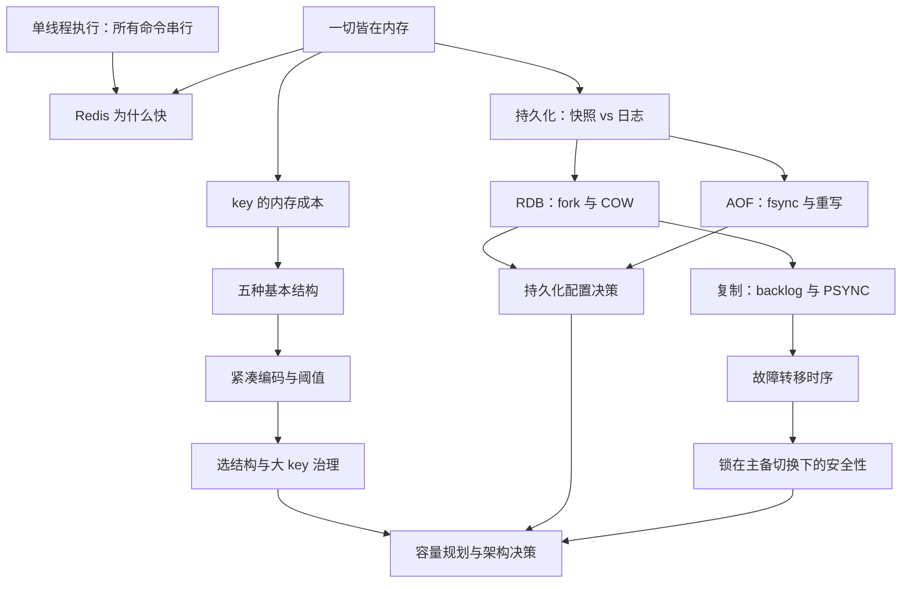

# Redis 架构决策手册

> 面向 Java 架构师的机制级 Redis 总结。组织原则：每个决策都能从机制重新推导，不依赖背诵。

------

## 第一部分：知识地图

整门课由两条普适断言生成，沿三条资源线展开：

**两条断言（一切的地基）**

1. **所有命令在一个主线程上串行执行**——无并发、无锁，任何时刻全实例只有一个命令在跑
2. **一切数据都在内存里**——RAM 是数据库本体，内存是唯一稀缺资源

**三条资源线（所有架构问题的归类法）**


| 资源线     | 消耗它的事物                                           |
| :--------- | :----------------------------------------------------- |
| 主线程时间 | 慢命令（KEYS *、大 key 操作）、fork 阻塞、fsync always |
| 内存       | key 门票、数据本体、COW 脏页、backlog、淘汰余量        |
| 持久性窗口 | RDB 快照窗口、AOF 1 秒、复制丢数窗口、锁失效瞬间       |





------

## 第二部分：机制手册

### 1. 单线程为什么快

推导链：内存操作微秒级（断言二）+ 串行无锁无争抢（断言一）+ epoll 多路复用消除 socket 等待 → 单实例 ~10 万 QPS。

- 单线程是**主动选择**而非妥协：白送每条命令的原子性（`SET NX PX`、Lua 脚本成立的原因）
- **唯一软肋**：任何非 O(1) 命令花的是所有人的时间
- Redis 6 io-threads 的精确位置：并行化 socket 读写与协议解析（高连接高 QPS 下这才是大头），**命令执行保持串行**

### 2. 一个 key 的真实内存成本

不带 TTL 的小 String key，账单三笔：


| 组件         | 大小                              | 说明                                                   |
| :----------- | :-------------------------------- | :----------------------------------------------------- |
| dictEntry    | 24 B                              | key 指针 + value 指针 + 冲突链 next                    |
| key 的 SDS   | 4B 头 + key 名长度，jemalloc 取整 | `u:10086` → 16B；`user_profile:10086` → 32B            |
| value 包装头 | ~20 B                             | robj 16B + SDS 头 3B + 终结符（embstr 与数据同笔分配） |

**经验数**：不带 TTL ≈ 60~90 B/key；带 TTL 加过期字典条目 ≈ 90~120 B/key。

**估算四步法**：①数组件 → ②加总单 key → ③乘 key 数（数量级放大在这步）→ ④加表级开销（桶数组 = ≥key 数的 2 的幂 × 8B）。

推论：key 名长度是真金白银（短前缀规范的原因）；TTL 不是免费的。

### 3. 五种基本结构


| 结构   | Java 类比            | 单操作复杂度                    | 典型场景                 |
| :----- | :------------------- | :------------------------------ | :----------------------- |
| String | 单值                 | O(1)                            | 缓存对象、计数器、锁     |
| Hash   | `Map<String,String>` | 单字段 O(1)                     | 对象多字段               |
| List   | `Deque`              | 两端 O(1)                       | 队列、时间线             |
| Set    | `HashSet`            | O(1)，交集 O(n·m)               | 去重、共同好友（SINTER） |
| ZSet   | 带分数的有序集       | **O(log n)**（跳表+字典双结构） | 排行榜、范围查、延时队列 |

选结构第一准则：**操作语义与结构语义对齐**——交集找 Set，排序找 ZSet，字段聚合找 Hash。

### 4. 紧凑编码：listpack 与阈值

- 小聚合（Hash/ZSet/小 List）连续打包进一块内存：无指针、无 per-field 对象头，单字段开销几字节
- 阈值：`hash-max-listpack-entries`（默认 **128**）、`hash-max-listpack-value`（默认 **64B**）
- 突破阈值 → **透明转换为 hashtable**（内存跳升、访问回 O(1)）；转换**单向不可逆**
- 为什么必须有阈值：紧凑结构查询 O(n)，大 n 在单线程上是灾难
- 通用引擎：**「小用紧凑、大用索引，阈值自动切换」**（intset、quicklist、skiplist 同此模式）

### 5. RDB：fork 与写时复制

- `fork()` 子进程共享父进程物理页（零拷贝），谁写谁复制（4KB 页粒度）→ 时间点一致快照，主线程仅在 fork 瞬间阻塞（页表复制，GB 级约几十~几百 ms）
- 成本结构：**窗口期写入越猛，脏页越多，内存上涨越多；最坏翻倍**
- 规则：可用内存 ≥ 数据量（防最坏情况）；bgsave 安排在写入低谷
- 固有缺陷：两次快照间的写入，宕机全丢

### 6. AOF：日志、fsync 与重写

- 机制：写命令以协议文本追加；恢复 = 重放
- fsync 三档（同构于 InnoDB flush_log_at_trx_commit）：


| 档位                 | 丢数   | 吞吐                                            |
| :------------------- | :----- | :---------------------------------------------- |
| always               | ≈0     | 磁盘 IOPS 量级（数百~数千），杀死内存数据库意义 |
| **everysec（默认）** | ≤1 秒  | 几乎无损——工程最优折中                          |
| no                   | 几十秒 | 最好但不可控                                    |

- **AOF rewrite**：fork 子进程遍历当前内存，输出**最小重建命令集**（一百万条 INCR 折叠成一条 SET）；rewrite 期间新写入双写缓冲，原子切换
- 恢复优先级：AOF 优先于 RDB；**混合持久化**（`aof-use-rdb-preamble`，默认开）：新 AOF = RDB 格式快照 + 增量命令，兼得加载速度与完整性

### 7. 复制：backlog 与 PSYNC

- 复制**独立于持久化**存在（纯缓存全关持久化也要主从；AOF 会被 rewrite 作废偏移量）
- **backlog**：主节点内存中的固定大小环形缓冲区，写命令带全局递增 offset
- 从节点重连报 `(runid, offset)`：offset 在缓冲区内 → **增量补发**；已被覆盖 → **全量同步**（fork RDB → 传输 → 从节点清空加载——COW 账再付一次）
- **容量公式**：`backlog ≥ 预期断连时长 × 写带宽 × 安全系数(2~4)`
- **默认值 1MB 是陷阱**——高写入实例 0.1 秒就冲完一圈
- 异步是设计选择：同步复制会把每次写延迟绑到网络 RTT；代价是丢数窗口永远存在

### 8. 故障转移时序

根本困难：**「对方死了」和「我看不见对方」不可区分** → 必须多数派仲裁（任意两个多数派必相交，杜绝脑裂）。

Sentinel 时序：


```
主观下线（单哨兵超时）→ 客观下线（≥quorum 哨兵同意）→ 哨兵选 leader（类 Raft）→ 选新主（过滤断连 → replica-priority → 复制 offset 最大 → runid）→ 提升 + 其余从节点改挂 + 客户端经 Sentinel 重发现
```

Cluster 版（去中心化同构）：gossip 传播 → PFAIL 经多数**主节点**确认转 FAIL → 从节点按 offset 排名的延迟发起选举（数据最全者先发起）→ **主节点**过半投票（5 主需 3 票）→ 胜出者接管槽位。

选举**偏向**数据最全者，但只是偏向——丢数窗口无任何机制能彻底关闭。

### 9. 锁在主备切换下的安全性

事故链：A 抢到锁（主返回 OK，未复制）→ 主宕机 → 从升主（无锁 key）→ B 抢锁成功 → **双持锁**。Lua token 解锁防误删，防不了锁存在性丢失。

三层答案：

1. **Fencing token（治本）**：加锁发单调递增令牌，**被保护资源在写入点校验**（拒绝小于已见最大值的写入）。锁服务自己治不了——「我是否仍持有锁」只能由资源方在落笔时裁决
2. **Redlock（缩窗口）**：多数独立主节点加锁，但引入时钟依赖，且与 fencing 解决不同问题（Kleppmann–antirez 争论）
3. **架构裁决**：**Redis 锁是效率锁，不是正确性锁**。合法用途：缓存击穿互斥回源、任务防重。库存/资金的正确性底线必须由 DB 条件更新（`UPDATE ... WHERE n>0`）或乐观锁承担

------

## 第三部分：决策速查

### 选结构四步链


```
语义对齐（操作原生支持？）→ 门票摊薄（聚合成更少 key）→编码停留（规模控制在 listpack 阈值内）→ 大 key 红线（任何 key 规模必须有界）
```

### 持久化三问

1. **数据可重建？** 可 → 全关（纯缓存开持久化是纯成本零收益）
2. **RPO 容忍多少？** 会话级 → everysec；金融级 → everysec + 副本 + 应用层对账/幂等（**always 救不了 failover**——集群持久性天花板由复制决定，不由 fsync 决定）
3. **RTO 要多快？** → 混合持久化；RDB 另作冷备/误删恢复
4. （手法）延迟敏感主节点可关持久化，让从节点承担——COW 与 fsync 隔离在从节点

### 分片数公式

N=max⁡(⌈总QPS单分片∼8万⌉, ⌈总内存单分片上限∼20GB⌉)*N*=max(⌈单分片∼8万总QPS⌉, ⌈单分片上限∼20GB总内存⌉)

- 单分片上限 20GB 的依据：fork 页表成本、COW 余量、全量同步 RTO、淘汰抖动窗口
- 大 value 缓存集群通常**内存维度主导**
- 16384 是槽位数（CRC16 取模基数），**不是分片数上限**

### 热 key

单 key 永远路由到单分片——**Cluster 解决容量问题，不解决热点问题**。解法层次：应用本地缓存（Caffeine，毫秒级 TTL）→ 读副本轮询 → key 拆分多副本（`sku:1001:1..N`）。

### 阻塞风险清单（单线程推论）

KEYS *（改 SCAN）、大 key 的 DEL（改 UNLINK，lazyfree 后台释放）、HGETALL/SMEMBERS 全量取大聚合、bgsave 高峰触发、`appendfsync always`。

------

## 第四部分：五个场景复盘

**场景 A｜用户画像内存超标（7GB vs 1.6GB）**
2000 万独立 JSON String key，元数据门票 ~90B × 2000 万 ≈ 1.8GB，加 SDS/取整/桶数组/TTL/rehash 双表 ≈ 7GB。
解法：分桶 hash（16 万桶 × 125 field，value ≤64B 保 listpack）→ **≈1GB，省 85%**。若需 per-user TTL → 退回 per-user hash（TTL 是 key 粒度）→ ≈3.6GB，仍省一半。

**场景 B｜凌晨三点内存尖峰 + 40GB AOF**
bgsave 窗口遇批量写入 → COW 脏页复制（10GB→16GB）；AOF 无限增长 → rewrite 折叠。根决策：纯缓存 → **持久化全关**，宕机重建 + 预热。

**场景 C｜30 秒断连换 10 分钟全量同步**
默认 backlog 1MB，30 秒高写入冲掉几十圈 → offset 失效 → 全量（fork + COW + 传输 + 加载）。责任人不是网络，是 backlog。按公式调到 GB 级。

**场景 D｜秒杀超卖**
主备切换瞬间锁数据丢失 → 双持锁。正解：Redis 锁做流量削峰，DB 条件更新做正确性底线；需要 fencing 时由资源方校验 token。

**场景 E｜双十一容量评审（25 万 QPS / 8 亿 key / 1KB value）**
吞吐维度 ⌈25万/8万⌉=4 片；内存维度 ⌈880GB/20GB⌉=44 片 → **取 44 片**。每片 1 主 1 从跨机房；主关持久化、从留低频 RDB；backlog 按公式配；爆款热 key 由应用层本地缓存兜底。

------

## 一句话总纲

> 遇到任何 Redis 问题，先问：**它消耗哪条资源线——主线程时间、内存、还是持久性窗口？** 答案会自己长出来。

*未覆盖（后续入口）：Stream 与消息队列语义、客户端连接管理、可观测性（SLOWLOG / MEMORY USAGE）、Redis 7 特性细节。*